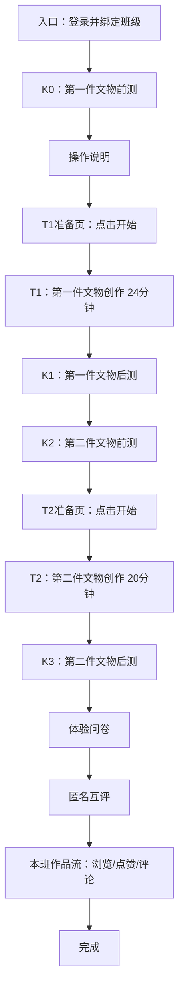
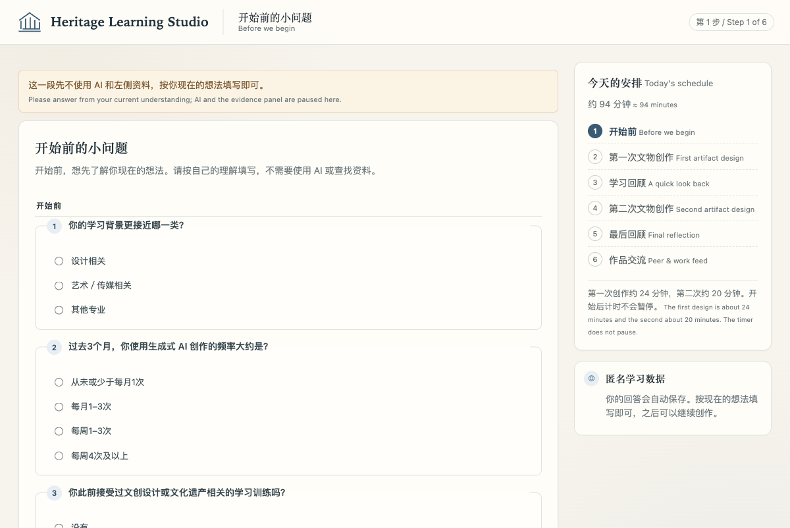
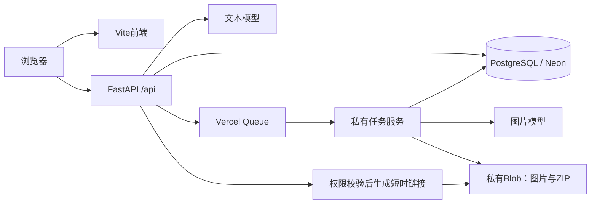

# Heritage Learning Studio

文化遗产知识学习与 AI 文创设计平台。参与者阅读两件文物的证据资料，在 AI 辅助下完成两轮产品设计、知识测评、体验问卷、匿名互评和站内作品互动；研究者通过后台管理材料版本、查看过程数据并导出记录。

项目采用 **React + TypeScript + FastAPI + PostgreSQL**，支持本地运行、Docker/Caddy 部署，以及 Vercel Services + Neon + 私有 Blob + Queues 的班级0内测部署。

本文以 **2026-11-08 的代码行为**为准。代码中的“正式内容 / formal”和“study模式”是内容与运行配置名称，不代表测评工具已完成学术效度验证。

## 阅读入口

- [学生与研究者交互手册](docs/USER_GUIDE_ZH.md)：逐页面操作、按钮、保存/恢复、图片失败处理、互评和后台流程。
- [部署与运维指南](docs/DEPLOYMENT_PUBLIC.md)：本地、Docker、Vercel、初始化、环境变量和回滚。
- [京东云 OSS](docs/JDCLOUD_OSS.md)：私有文件存储、图片缓存、原图下载和迁移。
- [接口与数据说明](docs/API_REFERENCE.md)：接口分组、权限、异步任务、数据表与导出。
- [当前 HLSF 框架](docs/HLSF_CURRENT_FRAMEWORK.md)：教学脚手架的设计背景。
- [AI 框架与提示原则](docs/AI_FRAMEWORK_AND_PROMPTING_ZH.md)：两种 AI 条件、四阶段状态机、提示原则与图像生成规则。
- [V2 测评说明](docs/ASSESSMENT_V2_PILOT.md)：题本与作品说明版本。
- [V2.1 体验问卷与同伴互评](docs/SURVEY_PEER_V21_PILOT.md)：七题问卷、P1–P3 互评、T1/T2 混合互评、导出字段与量表边界。
- [历史完整交接文档](docs/PLATFORM_COMPLETE_GUIDE_ZH.md)：较早的逐页/逐表记录；其中旧时长、单进程及部署限制应结合当前代码判断。

## 能做什么

| 面向对象 | 功能 |
| --- | --- |
| 学生 | 登录与进度恢复、K0–K3测评、24分钟T1和20分钟T2、证据资料阅读、AI对话、产品设计、概念图生成与选择、问卷、匿名互评、站内作品流 |
| 研究者 | 班级入口链接、进度和详情、文物/题本版本管理、协议冻结、准备检查、错误与生成记录、ZIP/CSV导出 |
| 部署者 | 本地文件或私有Blob、持久化图片任务、本地worker或Vercel队列、数据库协调限流/聊天锁、数据库迁移、备份与代码回滚 |

学生界面不显示G1–G4或A/B实验标签。作品流模拟社交互动，不连接真实Instagram，也不会把参与者作品自动发布到GitHub。

## 完整学习流程



| 阶段 | 主要交互 | 关键规则 |
| --- | --- | --- |
| 登录 | 输入登录标识、选择或由链接锁定班级 | `strip().lower()`后包含`polyu`即可；无额外口令/邮箱验证码/SSO |
| K0 | 基线问题与第一件文物知识前测 | 当前V2.4共11项（5项背景 + 6项知识题）；测评阶段不开放AI和资料 |
| 操作说明 | 阅读平台操作提示 | 完成后进入T1准备页 |
| T1 | 资料、AI、作品文字与概念图 | 点击“开始本轮”后服务端计时1440秒 |
| K1 | 第一件文物知识后测 | 当前V2共7项，含短答 |
| K2 | 第二件文物知识前测 | 当前V2共6项 |
| T2 | 用另一件文物完成新的设计 | 服务端计时1200秒 |
| K3 | 第二件文物知识后测 | 当前V2共7项，含短答 |
| 问卷 | 填写体验评价 | 当前V3.0共19项；两轮体验均在T2和K3后填写，各构念分开报告，不计总分 |
| 互评 | 对分配的匿名T1/T2作品独立评分 | P1–P3双语V2.2；排除本人；正式班每人12件（6 T1 + 6 T2） |
| 作品流 | 浏览、点赞/取消点赞、评论 | 仅本班；不能给自己的作品点赞或评论 |

题数取决于所激活的内容版本，演示题本和历史协议可能不同。提交阶段由服务端校验，修改浏览器地址不能跳过流程。刷新、退出、网络断开不会暂停已开始的创作倒计时。

更新已有环境时，部署源码后还需运行 `release-current-content --dry-run` / `--activate`，核对数据库启用题库。[统一双语发布说明](docs/UNIFIED_BILINGUAL_RELEASE.md)。

当前K0界面示例：



## 创作工作台怎样交互

工作台由三个区域组成：

1. **文物资料**：查看原图/局部图、介绍、观察事实、历史来源与不确定信息；展开章节会形成资料访问事件。
2. **AI对话**：围绕文物理解和设计提问。B条件额外显示Observe → Explain → Create → Reflect引导，支持阶段提示、一次提示帮助及跳过。
3. **我的文创设计**：填写产品名称、类别/用途、目标受众、三段作品说明，生成并选择一张概念图，然后“保存并继续”。

当前V2的三段说明在两种条件、两轮创作中一致：

| 字段 | 写什么 |
| --- | --- |
| `heritage_knowledge` | 使用了哪些文物知识、图像观察或资料证据 |
| `cultural_translation` | 如何把这些知识转化为产品的图案、结构或用途 |
| `design_reason` | 为什么这样设计；哪些属于设计推测或个人选择 |

文字自动保存并产生版本。图片生成异步执行，页面展示排队、执行、成功或失败状态；成功后需选择用于提交的图片。图片失败不会强制阻塞文字作品提交。提示词优化失败或供应商结果不明会明确报错，用户可以手动重试。

详细按钮行为和恢复流程见[交互手册](docs/USER_GUIDE_ZH.md#创作工作台)。

## A/B条件与分组

A为自由AI对话；B在相同模型和创作工具上增加HLSF引导。新参与者按班级分配G1–G4，每个人接触两件不同文物，并经历一次A、一次B。

| 分组 | T1 | T2 |
| --- | --- | --- |
| G1 | X + A | Y + B |
| G2 | Y + A | X + B |
| G3 | X + B | Y + A |
| G4 | Y + B | X + A |

当前新运行设计版本为`crossover-v1.1-assessment-v2-pilot`，测评版本为`assessment_v2.0_pilot`。历史运行保留原协议，不能仅根据当前分组表解释旧数据。

## 班级0内测与正式模式

`ENVIRONMENT`决定HTTPS、Cookie和生产密钥要求；`DEPLOYMENT_MODE`决定可用班级。`beta`仅开放班级0；`study`允许班级0与正式班1–4共存。班级0始终采用个人互评快照，正式班仍使用全班闸门。

| 项目 | `DEPLOYMENT_MODE=beta` | `DEPLOYMENT_MODE=study` |
| --- | --- | --- |
| 可用班级 | 仅0；后端拒绝1–4 | 班级0及1–4 |
| 登录规则 | 输入包含`polyu` | 同左 |
| 报名 | 持续接受新用户 | 班级0持续开放；正式班容量受限、互评开放后冻结成员 |
| 互评开放 | 个人完成问卷后分配 | 班级0使用个人快照；正式班等全班已进入用户的T2结束 |
| 分配 | 从当时其他用户的有效T1/T2作品中取最多6份，优先成对展示 | 班级0同左；正式班冻结班级批次并平衡分配 |
| 作品不足 | 按实际数量；0份时允许继续 | 班级0同左；正式班依据冻结池分配 |
| 后续新作品 | 不改变已分配的个人快照 | 班级0同左；正式班不改变已冻结批次 |
| 数据隔离 | 独立部署时使用自己的数据库、存储和环境变量 | 共存时以class_id区分，正式分析排除班级0；需要物理隔离时另建beta部署 |

班级链接`/join?token=...`只负责班级绑定，不承担身份验证。内测没有邀请口令或邮箱所有权校验。当前规则允许知道同一登录标识的人恢复该账号；使用前应理解这项身份边界。

后台会按班级保留每条有效链接的完整地址和复制按钮。生成其他班级链接、刷新或重新登录后仍可查看；重新生成会使原链接失效。旧版仅存随机token哈希的链接需重新生成一次。实现与迁移见[链接保留说明](docs/CLASS_LINK_PERSISTENCE_20261109.md)。

## 快速体验：本地模拟模式

适合在**全新克隆目录**检查交互，不需要真实模型密钥。要求Python 3.12、Node.js 20+；测试依赖中的`pgserver`启动本地PostgreSQL。

```bash
git clone https://github.com/zgslbtl/heritage-learning-studio.git
cd heritage-learning-studio
python3.12 -m venv backend/.venv
backend/.venv/bin/python -m pip install -r backend/requirements-dev.txt
npm --prefix frontend ci
```

终端1，在项目根目录启动模拟后端：

```bash
backend/.venv/bin/python scripts/dev_runtime.py
```

终端2，在项目根目录启动前端：

```bash
npm --prefix frontend run dev
```

打开`http://127.0.0.1:5173`，用例如`polyu-demo-01`进入班级0。后台为`http://127.0.0.1:5173/admin`，这个**本地模拟启动器**的固定演示密码为`local-dev-admin-password-123`。

模拟回复明确标记`LOCAL TEST STUB`，图片是占位图；不代表真实AI输出。`scripts/dev_runtime.py`默认重建`.local-runtime`下的演示数据库并清空其中的演示文件，不能对研究数据目录运行。`HLS_PRESERVE=1`只用于保留同协议的本地演示；真实数据使用独立数据库部署方式。

## 本地真实服务与生产部署

真实运行需要独立配置文本模型和图片模型，密钥只保存在服务端。

- **本地真实服务**：配置`backend/.env`、PostgreSQL和持久化目录，迁移后导入/激活V2内容；参见[本地部署步骤](docs/DEPLOYMENT_PUBLIC.md#本地真实服务)。
- **Docker**：复制根目录`.env.example`为`.env`，填好域名、数据库、密钥和模型配置，再执行`docker compose up -d --build`。只对外开放Caddy的80/443端口。
- **Vercel内测**：根目录`vercel.json`定义web/api/tasks三个服务；独立Neon数据库、私有Blob、队列消费者和环境变量；迁移及内容导入是独立初始化步骤。



本地和Docker使用持久化文件目录及本地图片worker；云端使用同一存储接口、数据库任务状态和Vercel队列，不依赖常驻Python进程。

Vercel默认域名在某些网络下可能连接超时。本项目曾实测代理可达而同机直连失败，服务健康正常不等于所有参与者网络可达；分享前应在目标网络下测试登录、文件和模型任务。推送GitHub不会自动解决这个访问问题。

### 关键配置

完整示例见[.env.example](.env.example)。

| 变量 | 作用 |
| --- | --- |
| `ENVIRONMENT` | `development`或`production`；生产要求长密码/pepper、HTTPS和Secure Cookie |
| `DEPLOYMENT_MODE` | `study`或`beta` |
| `DATABASE_URL` | PostgreSQL连接；Neon连接使用TLS |
| `ADMIN_PASSWORD` / `ANON_CODE_PEPPER` | 后台密码和分配/旧访问码pepper；分配参与者后不要更换pepper |
| `PUBLIC_ORIGIN` / `COOKIE_SECURE` | 精确前端origin；HTTPS部署设`true` |
| `STORAGE_BACKEND` / `QUEUE_BACKEND` | 本地`local/local`；Vercel使用`blob/vercel` |
| `DATA_DIR` | 本地持久化目录；Vercel只作临时缓存 |
| `TEXT_MODEL_*` | OpenAI兼容Chat Completions文本接口、模型、密钥、超时 |
| `IMAGE_MODEL_*` | 独立Images Generations接口、模型、密钥、超时、输出尺寸 |
| `IMAGE_MAX_CONCURRENCY` | 图片并发上限，默认2 |
| `IMAGE_JOB_LIMIT_PER_ROUND` | 每轮图片额度；`0`代表不限制连续生成次数 |
| `BLOB_READ_WRITE_TOKEN` / `BLOB_STORE_ID` | 私有Blob服务端访问配置 |
| `DB_NULL_POOL` | 多实例/serverless部署使用`true` |
| `AUTO_BOOTSTRAP` / `IMAGE_WORKER_ENABLED` | 本地启动控制；Vercel均设`false`并独立初始化 |

不同供应商的API契约可能不同；模板中的模型名只是可修改的配置示例，不保证供应商长期保留该名称。客户端没有`VITE_*`模型密钥。

## 数据、隐私与导出

平台保存登录标识、阶段进度、对话、作品版本、图片提示词与任务、测评草稿/提交、HLSF事件、资料访问、互评和社交互动。登录标识明文保存在数据库，仅研究者后台可查看；导出以参与者UUID连接记录，不包含邮箱、会话Cookie、访问码或模型密钥。

后台“导出完整研究数据”在云端创建异步任务，成功后显示“下载数据ZIP”。ZIP包含CSV、协议快照、数据字典、清单和可用媒体；清单记录缺失文件及是否为beta内测环境。互评评分是参与者评价，不等同于文物史实专家评分。

本仓库公开代码、题本、参考资料、历史说明及工程截图；**不包含实际参与者数据库、运行导出包、后台凭据、模型密钥和本机环境文件**。公开题本含研究者答案，后续使用需考虑题目公开对测评的影响。原始参考资料与文物图片的权利及来源需分别核对，仓库公开不代表对全部材料授予统一再使用许可；本次未新增开源许可证。

## 目录结构

```text
.
├── README.md                    # 当前入口与核心规则
├── .env.example                 # 无真实密钥的配置模板
├── vercel.json                  # Vercel Services与私有队列触发器
├── docker-compose.yml           # Caddy / API / PostgreSQL
├── backend/
│   ├── app/routers/             # 登录、学生、后台、文件和云端接口
│   ├── app/services/            # 流程、HLSF、任务、存储、互评、导出
│   ├── app/content/             # 文物、V1/V2题本、评分元数据及静态图片
│   ├── alembic/versions/        # 0001–0017数据库迁移
│   └── tests/                   # 后端自动化测试
├── frontend/
│   ├── src/pages/              # 学生阶段页与后台
│   ├── src/components/         # 资料、内容编辑、导出、互评闸门等
│   ├── src/tests/              # 组件测试
│   └── e2e/                    # Playwright测试源码
├── scripts/                    # 本地模拟、真实服务验收、备份及静态检查
├── docs/                       # 公开交互手册与既有设计/交接文档
├── reference/                  # 原有参考文章、研究材料和文物资料
└── e2e/screenshots/             # 历史工程交互截图
```

历史文档中可能描述旧版本行为：例如T2仅A、14分钟、前端DEV决定班级0或内存限流。请优先使用本文、新交互手册与对应源码；不要将旧记录当作当前部署的验收证明。

## 测试与验证范围

在项目根目录安装依赖后运行：

```bash
# 必须在backend目录运行，读取该目录的pytest配置。
(cd backend && .venv/bin/python -m pytest -q)

npm --prefix frontend run typecheck
npm --prefix frontend test
npm --prefix frontend run build

# 静态部署检查；不等于Docker运行或HTTPS证书验收。
backend/.venv/bin/python scripts/check_deployment.py
```

最近一次本地完整验证为后端**94项通过（Python 3.12，无跳过）**、前端**28项通过**及生产构建通过。后端模型接口采用测试桩，覆盖流程、隔离、迁移、失败恢复、互评、导出和并发等工程行为；不据此推断模型质量。

独立Vercel内测另外验证了真实两轮文本/图片生成、0份/1份互评池、退出恢复、私有文件权限、大文件直传、后台导出及重新部署后持久性。一次图片供应商瞬时失败被保留，并通过显式手动重试完成。没有据此声称完成大规模真实供应商负载验收或正式研究效度验证。

真实云端验收脚本是主动操作工具，会创建合成账号、提交测评、调用收费模型并生成文件；不会由普通单元测试自动运行：

```bash
# 先向终端环境注入目标部署的ADMIN_PASSWORD；不要把真实密码写入命令历史。
backend/.venv/bin/python scripts/vercel_beta_smoke.py \
  --base-url https://YOUR-PROJECT.vercel.app \
  --report test-artifacts/vercel-beta/acceptance.json
```

## 常见问题

<details>
<summary>普通邮箱可以直接进入吗？需要邀请口令吗？</summary>

当前只检查输入归一化后是否包含`polyu`。不包含则拒绝；包含即可，不额外验证邮箱归属，也没有班级0口令。链接只固定班级。

</details>

<details>
<summary>为什么班级0没有等全班就能互评？</summary>

班级0为陆续加入的内测用户设计，每人首次进入互评时冻结个人分配。没有其他有效作品也允许继续。正式模式保持全班T2结束后的统一闸门。

</details>

<details>
<summary>刷新或重新登录后能恢复吗？计时会重置吗？</summary>

已成功保存的数据来自服务端。重新使用同一登录标识和班级会恢复原run，计时不重置；关闭页面也不会暂停倒计时。本地未成功同步的草稿应先检查页面恢复提示。

</details>

<details>
<summary>图片一直排队或失败怎么办？</summary>

本地检查worker、模型配置和任务错误；Vercel检查私有队列消费者、数据库投递状态和租约。不要通过批量重放消息重复调用供应商；结果不明时先看任务错误，再由用户手动启动新尝试。

</details>

<details>
<summary>打开Vercel链接超时，但健康检查正常？</summary>

健康检查只覆盖执行检查的网络路径。应分别检查浏览器网络、DNS、代理、域名和资源访问；换域名后也需要在实际参与者网络重新验收。

</details>

## 贡献与研究使用

修改流程前先确认设计版本、历史数据兼容性和班级模式；涉及迁移或导出时保留旧记录可解释性。请在issue中提供脱敏复现步骤与request ID，不要粘贴真实邮箱、对话、API密钥、数据库地址或签名下载链接。

该平台仍需结合具体研究的内容审查、评分流程、知情同意及数据管理安排使用。工程功能通过测试不代表工具效度或学习效果已经得到验证。
