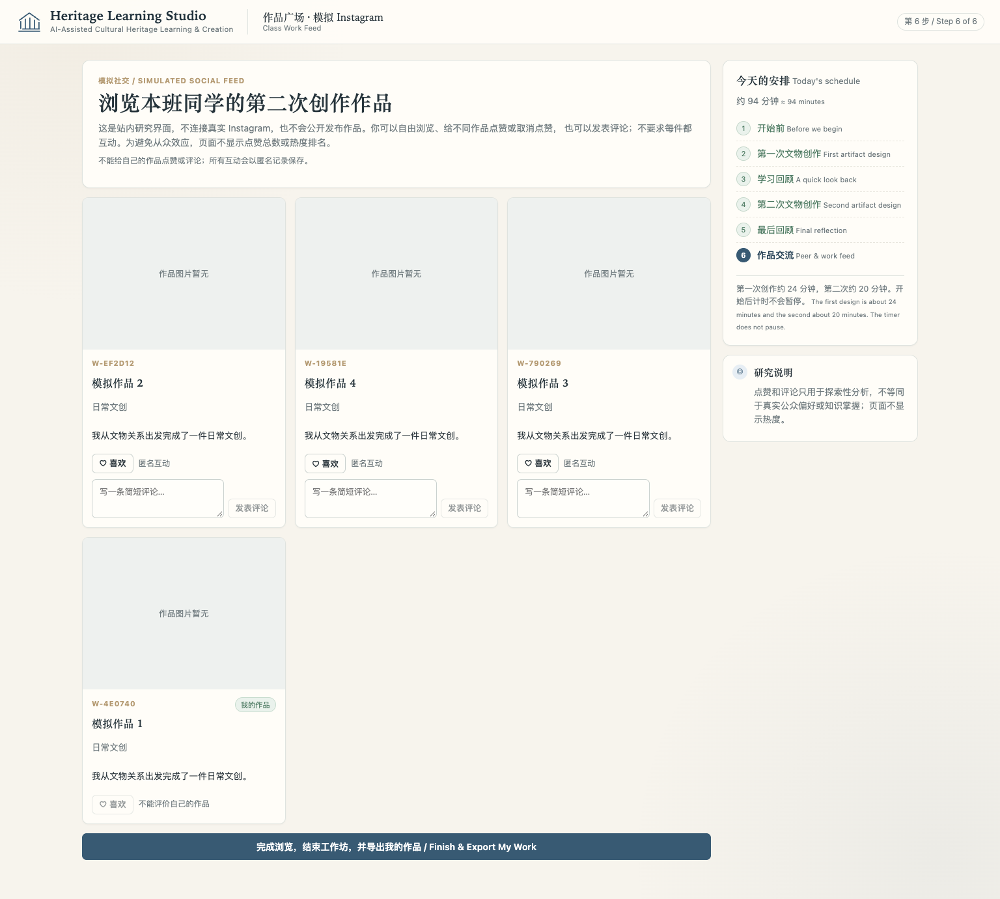
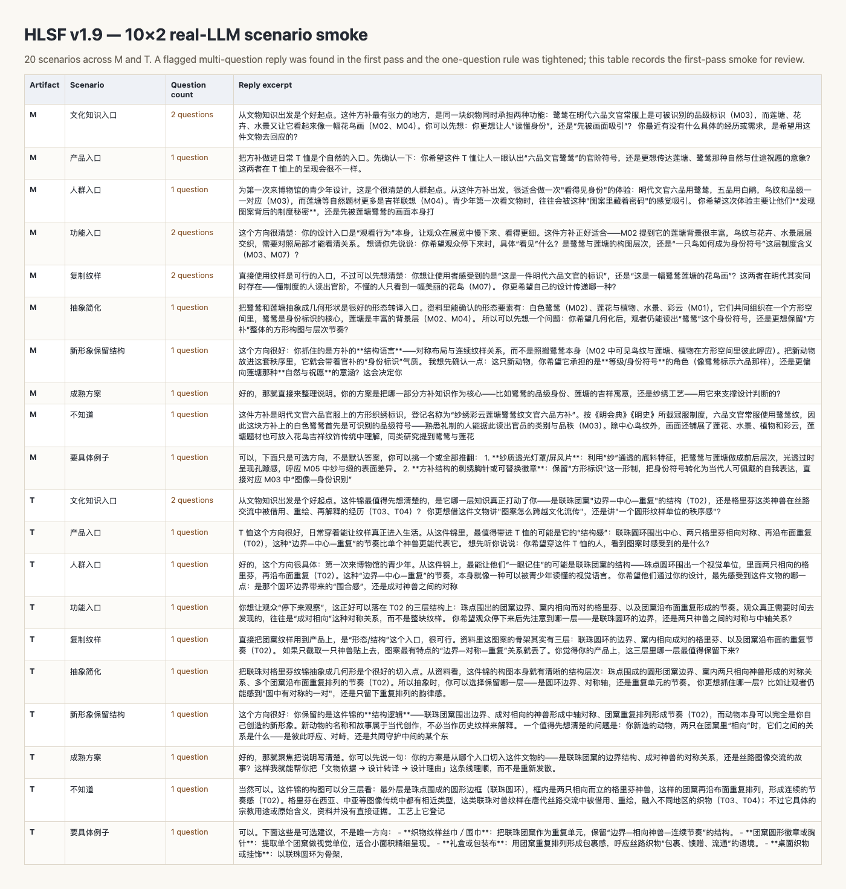
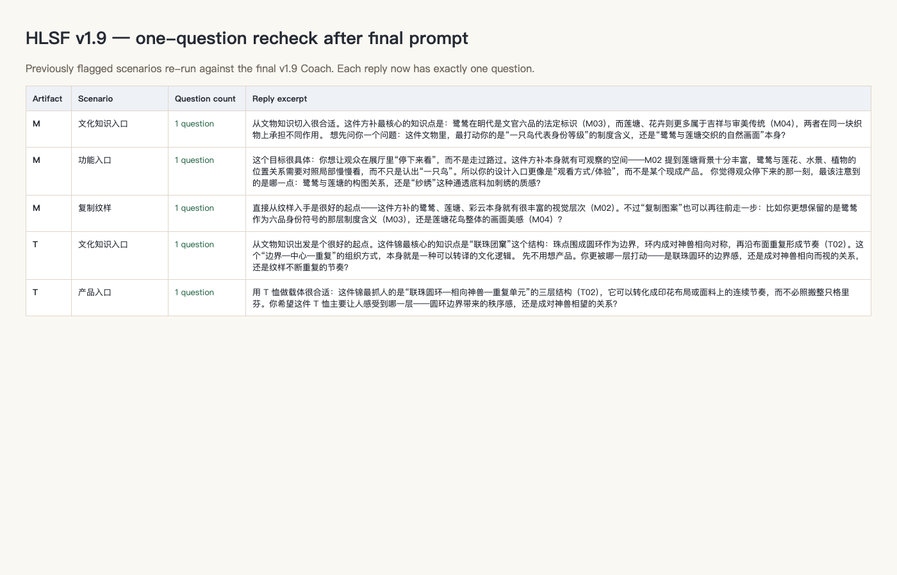
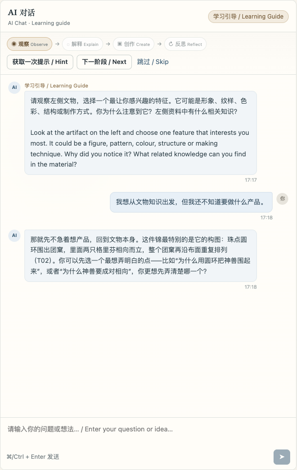
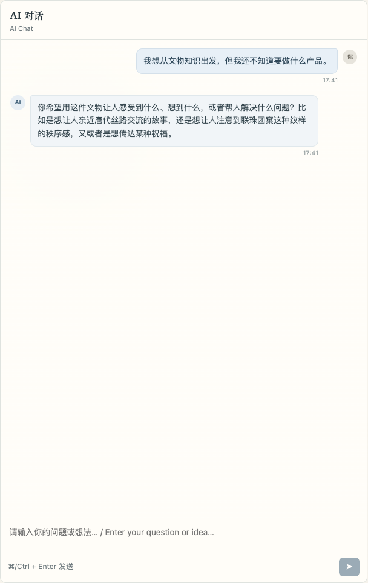
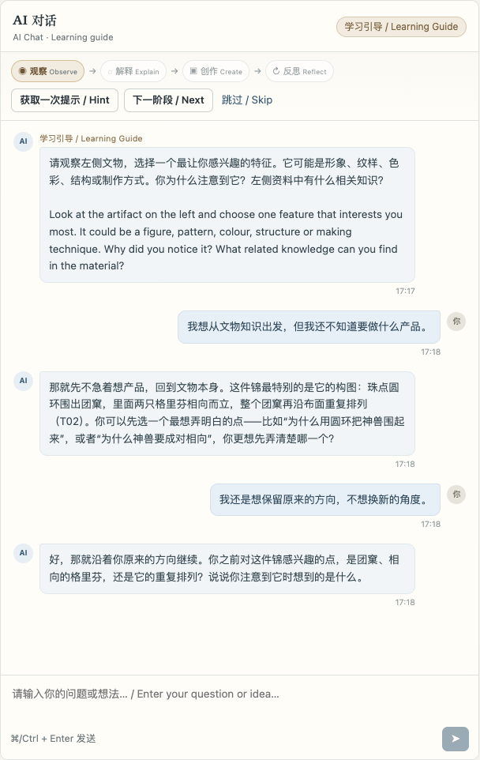
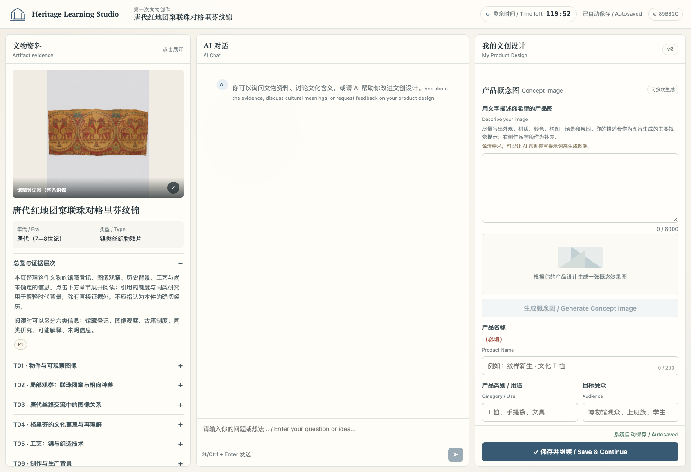

# HLSF v1.9 Full-Flow Simulation Report

日期：2026-11-08  
环境：本地 v1.9 preview（Class 4，真实文本模型，图片队列未纳入本次对话 smoke）

## 1. 已完成流程

四个模拟账号完整走通：

```text
K0 → T1 → K1 → K2 → T2 → K3
→ 体验问卷 → 同伴互评 → 作品广场
→ 下载 PDF → 完成工作坊
```

- 账号：`sim.1`–`sim.4`
- 班级：Class 4
- 同伴互评：每人 6 条，全部提交后 gate 打开
- 最终页：显示本班 T2 作品、自己的作品和最终导出按钮
- PDF：`e2e/screenshots/sim-portfolio.pdf`，文件头 `%PDF`

截图：



## 2. 10×2 真实模型场景

两件文物 × 10 个设计入口共 20 次真实文本模型请求。

第一轮 smoke 中发现 5 个回复有两个问号，例如：

- M 文化知识入口；
- M 功能入口；
- M 复制纹样；
- T 文化知识入口。

随后在 v1.9 Coach 中加入：

> 一次回复最多一个问号；一个选择问题后不得追加第二个问题，也不得换一种说法重复同一个问题。

5 个被标记场景已重跑，全部为 1 个问号。最终 20 条 smoke 中仍有 1 条 M 产品入口出现两个问句；加入“最多一个问号”规则后单独重跑，已变为 1 个问号。

这说明 soft prompt 仍不能保证 100% 一次一问，正式 Pilot 必须逐条人工审核。

报告截图：





## 3. 学生未提出产品前，AI 是否推荐产品

### HLSF B

真实对话：

学生：

```text
我想从文物知识出发，但我还不知道要做什么产品。
```

AI 先回到文物结构，没有给出产品清单；最后只问一个观察选择。

截图：



### Standard A

A 条件现在也使用同一条**学生自主性约束**，但不加入 HLSF 阶段、Coach 或教学追问：

```text
学生未提出产品、功能、人群、情境或方向前：
不列具体产品、产品类别、用途/场景菜单或完整设计方案。

学生明确要求例子时：
可以给简洁的可选建议。
```

版本标记：

```text
chat-v2+standard-guardrail-v1
```

旧 run 仍保持旧 Standard 行为；新 run 才应用该 guardrail。

真实对话：



## 4. 学生拒绝新视角

学生：

```text
我还是想保留原来的方向，不想换新的角度。
```

AI：

> 好，那就沿着你原来的方向继续。你之前对这件锦感兴趣的点，是团窠、相向的格里芬，还是它的重复排列？说说你注意到它时想到的是什么。

AI 没有继续推销新角度；保留了学生的原方向。

截图：



## 5. Standard AI 是否受 v1.9 影响

A 条件页面：

- 没有四阶段导航；
- 没有 Hint / Next / Skip；
- 没有 HLSF 教练提示；
- 没有 v1.9 系统规则。

截图：



自动化测试还确认 A 条件上下文不含：

```text
hlsf-v1.9-open-design-exploration-pilot
DESIGN_COACH_B_V19
Current coaching phase
```

## 6. 20–24 分钟完成性

**未能用当前 preview 做有效验证。**

当前 preview 使用：

```env
T1_DURATION_SECONDS=7200
T2_DURATION_SECONDS=7200
```

即截图中的 T1 计时为 `119:47`，不是正式研究的 24 分钟。

脚本化完整流程本身只需约 1.3 秒（API 自动化，不代表学生真实创作时间），因此不能作为“20–24 分钟可完成”的证据。

正式 Pilot 必须：

- 将 preview 设置为 T1=1440 秒、T2=1200 秒；
- 用真实学生/真人模拟完整创作；
- 记录实际完成时间、跳过率和未完成原因；
- 不能把 API 快速流程当作时间可行性证据。

## 7. 结论

| 检查项 | 结果 |
|---|---|
| 完整 K0→PDF→完成流程 | 通过 |
| 10×2 场景覆盖 | 已跑 20 条；仍有 soft prompt 一次一问风险 |
| 两个连续问句 | 最终规则收紧；已重跑标记案例，但需正式 Pilot 全部复核 |
| B 未提出产品前推荐产品 | 未观察到具体产品清单 |
| A 未提出产品前推荐产品 | 新 run 已加共享 guardrail；旧 run 保持原行为 |
| 学生拒绝新视角 | 尊重原方向 |
| A 条件 HLSF 隔离 | 通过；A 只加共享 guardrail，不加 HLSF 阶段 |
| 20–24 分钟完成性 | 未验证；preview 计时为 120 分钟 |

## 8. 仍需人工完成

- 用正式 T1=24 min / T2=20 min 配置做真人 Pilot；
- 逐条复核最终 20 条回复是否只有一个问号；
- 检查是否有模型把“可选例子”误解成默认推荐；
- 检查学生拒绝后是否有重复劝说；
- 检查 20–24 分钟内能否完成三段说明和图片流程；
- 在生产域名重新部署后再做一次 A/B 对比。
