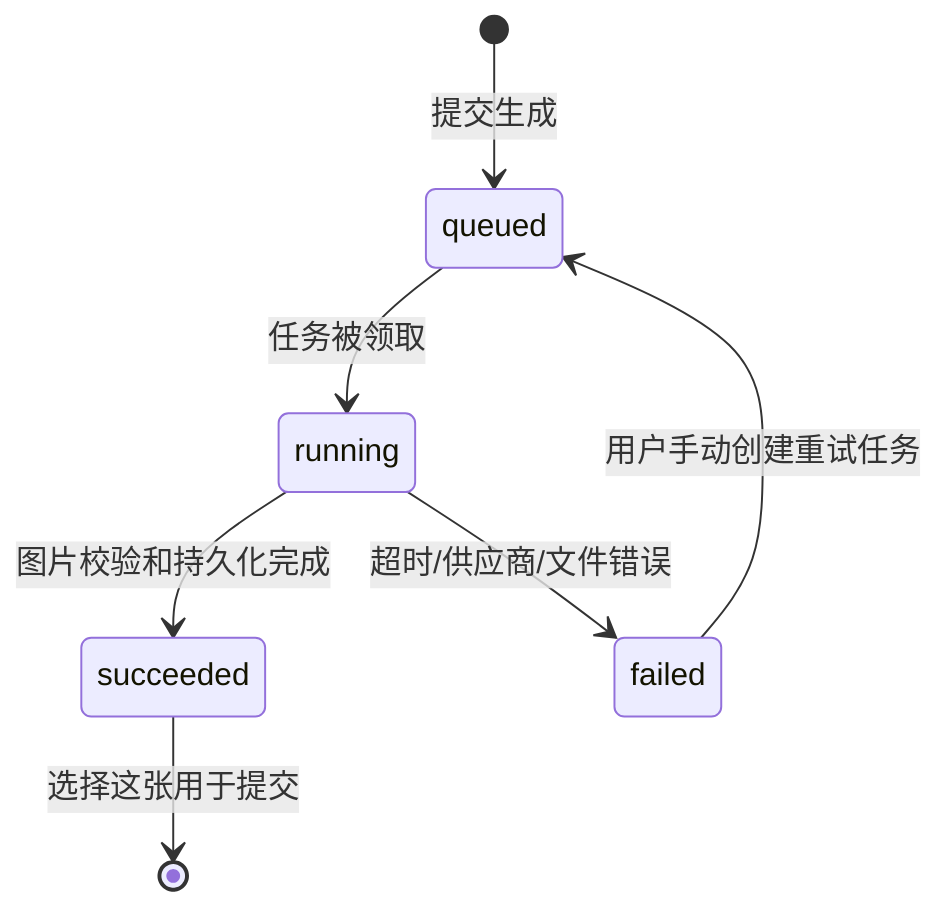

# 学生与研究者交互手册

对应2026-11-07代码。本文解释当前界面实际支持的操作；题目、文物及协议以部署者激活的版本为准。配置和命令见[部署指南](DEPLOYMENT_PUBLIC.md)，接口见[接口说明](API_REFERENCE.md)。

## 入口与登录

| 页面 | 用途 |
| --- | --- |
| `/` | 普通学生入口，可用班级从服务端读取 |
| `/join?token=...` | 班级专属入口，验证链接后固定班级 |
| `/admin` | 研究者后台，独立密码登录 |

### 第一次进入

1. 打开研究者提供的完整链接，等待班级配置加载。
2. 查看当前班级。班级0内测模式只显示0；专属链接下不能自行改班。
3. 输入自己的登录标识。界面称为邮箱，但服务端实际规则是去除首尾空格、转小写后包含`polyu`。
4. 点击“开始创作”。首次进入创建参与者和run，已有账号恢复原阶段。

例如`POLYU-demo-01`与` polyu-demo-01 `视为同一个输入；`demo@example.com`不满足规则。输入`polyu`也符合当前字符串规则，不需要额外邀请口令、验证码或校内账号认证。测试者应使用独立标识，不要借用他人的输入。

### 登录失败怎样处理

| 现象 | 原因/处理 |
| --- | --- |
| “开始”不可点击 | 等待入口配置/链接验证；确认输入非空；如加载失败按错误提示刷新 |
| 不含polyu被拒绝 | 使用符合既定规则的自己的输入 |
| 链接无效或已撤销 | 向研究者索取当前有效链接 |
| 已有邮箱属于另一班级 | 同一输入不能跨班新建；恢复原班级，不要直接修改请求 |
| 正式班级已关闭 | 互评开放后不再接受新账号；已有账号仍可恢复 |
| 设置尚未完成 | 研究者需要完成内容导入和协议激活 |
| 请求过于频繁 | 等待错误提示中的重试时间，不要持续点击 |
| 浏览器连接超时 | 尚未进入应用，应检查网络、DNS、代理和域名可达性 |

当前登录不是邮箱所有权验证。退出会撤销当前会话；重新输入同一标识即可恢复。共享电脑请操作“退出登录”。

## 测评、问卷与教程

### K0 → 教程 → T1

K0先询问基线情况，再呈现第一件文物的知识前测。当前V2是3项基线加6项知识题。按页面提示回答，必填项未完成时提交会给出错误。

答案先保存为草稿，刷新时从服务端读取；提交后该阶段结束。测评阶段不提供AI聊天、图片生成或证据资料工具，服务端也拒绝绕过界面调用这些功能。

完成K0后阅读操作说明，再进入T1准备页。**准备页显示任务不等于已经开始计时**，点击“开始本轮”才由服务端记录开始和截止时间。

### K1 → K2 → T2 → K3 → 问卷

- T1结束后完成K1后测。
- 接着完成另一件文物的K2前测，再开始T2。
- T2结束后完成K3后测和体验问卷。
- 当前V2的K1/K2/K3/问卷分别为7/6/7/7项；题本版本不同可能变化。

草稿保存失败时应保留页面和错误信息，网络恢复后确认已保存再继续。提交并进入下一阶段后，不能仅凭浏览器后退重新编辑已提交答案。

## 创作工作台

### 三个工作区域

| 区域 | 学生可做的操作 | 系统保存什么 |
| --- | --- | --- |
| 文物资料 | 阅读介绍、展开章节、看原图/局部和来源 | 资料访问事件和相关时间信息 |
| AI对话 | 输入问题、发送、查看回复、重试失败消息；B条件下使用引导 | 用户消息、可见回复、模型调用/错误、引导事件 |
| 我的文创设计 | 编辑产品和说明、生成/选择图、保存并继续 | 文字修订、提示词、图片任务、选图和提交记录 |

建议先阅读文物，再向AI提问，逐步形成产品，而不是把AI生成的文化解释直接当作已核实史实。资料本身区分登记信息、图像观察、历史背景、设计解释和未明信息。

### 时间与保存

- T1默认24分钟，T2默认20分钟，以服务端截止时间为准。
- 网络中断、退出或关闭浏览器不暂停计时。
- 修改产品文字后会自动保存；页面底部显示保存状态，保存错误会明确提示。
- 刷新时恢复已经同步的数据和图片任务；未同步草稿可能出现本地恢复提示，需要按页面选择处理。
- 截止后服务端结束本轮并推进到测评，不能通过修改设备时钟延长。
- 已结束轮次禁止继续编辑；历史文字和图片仍可在研究者记录中追踪。

### 填写产品与说明

当前V2两轮都使用相同的三段说明：

1. **文物知识依据**：哪些信息来自资料、图像或可靠证据。
2. **文化转译**：如何将这些依据变成产品中的图形、布局、结构或用途。
3. **设计理由**：面向谁、为什么这样处理，哪些是自己的选择或推测。

产品名称、类别/用途、目标受众和三段说明由当前表单校验；界面给出长度上限。三段建议合计100–150字，建议字数本身不是强制门槛。旧协议可能显示六字段或开放说明，不要把旧记录强行转换成新字段。

图片提示词是单独的输入。写清产品、图形位置、材料/风格和呈现要求，比直接粘贴全部资料更容易得到可检查的产品概念图。

### AI聊天与失败重试

1. 输入问题并发送，等待服务端完成回复。
2. 未收到回复时先看错误，再使用“重试这条消息”。
3. 系统通过消息ID和数据库协调防止并行重复提交；不要在多个窗口连续重复发送。
4. 文本模型不可用时，错误不会伪装成正常AI内容。

刷新后以服务端消息为准。模拟启动器中的回复带`LOCAL TEST STUB`标记，表示工程演示。

### HLSF引导

B条件的聊天区域显示四阶段：

| 阶段 | 主要活动 |
| --- | --- |
| Observe / 观察 | 识别可见构图、纹样、物件特征 |
| Explain / 解释 | 结合资料讨论文化与历史含义，区分证据和推测 |
| Create / 创作 | 把文物理解转化为具体产品设计 |
| Reflect / 反思 | 检查设计、证据联系和文化表达 |

每阶段有固定提示，可使用一次帮助提示，也可“跳过”或继续下一阶段；服务端保存当前阶段及操作。后续提示会结合已保存的产品记录。A条件保留自由聊天，不显示该引导条。学生界面不显示A/B或分组名称。

### 生成与选择概念图

“手动重试”会创建关联的新尝试，不会把旧失败记录抹掉。

| 界面状态 | 学生操作 |
| --- | --- |
| 提交中 | 等待，避免重复点击 |
| 排队 | 可以继续编辑文字；页面会查询状态 |
| 生成中 | 等待供应商处理；不要误认为尚未提交 |
| 成功 | 查看候选图并点击“选择这张”；选中项显示“已选用于提交” |
| 失败 | 阅读错误，修改需求或手动重试；也可继续完成文字作品 |

云端会保存提示词优化和供应商结果检查点。供应商调用已开始但结果不明时，不自动重新生成；成功任务收到重复队列消息也不再次调用模型。平台配置可限制每轮次数，默认`0`表示不限连续尝试次数，并不表示生成免费。

### 保存并继续

点击底部“保存并继续”，系统先保存并校验本轮最低文字要求，再结束本轮。若缺少必填字段，按错误补齐；图片失败本身不阻塞文字提交。T2页面有学习数据用于后续研究的说明及对应提交记录，研究者仍需按自己的研究安排完成知情同意流程。

## 匿名互评

### 班级0：陆续参与

完成问卷后，第一次读取互评时为当前用户建立固定快照：从当时可用的其他用户有效T2作品中分配最多6份，排除本人作品。

- 有1–5份可用作品：按实际数量分配。
- 没有其他作品：显示空池说明，可以直接进入作品广场。
- 后来有人完成：不会向已经分配过的用户追加或替换任务，包括空快照。
- 某个用户停留K0或中途离开：不会阻塞其他人的班级0互评。

### 正式班级：自动全班闸门

正式模式等待本班所有**已经创建用户**的T2结束。没有进入的人不算等待对象；T2超时算结束，但不完整作品可能不进有效池。仍停留早期阶段且尚未结束T2的账号会继续阻塞，需要研究者按现场预案处理。

闸门开放时冻结班级成员和批次；没有管理员手动提前开放按钮。之后新账号不能加入该正式班，已有账号可以恢复。

### 评分操作

1. 逐件阅读匿名产品、图片和作品说明。
2. 对页面显示的三个维度分别选择1–5分；可填写简短意见。
3. 点击“提交这件评价”，该卡片变为“已提交”。
4. 完成所有分配作品后，点击“完成互评，进入作品广场”。0份分配可以直接继续。

作者姓名、邮箱和他人评分不会展示给评价者；自己的评分也不会作为作品流评论显示给作者。互评意见与后面的社交评论是不同数据。

## 作品广场与完成

作品广场展示本班有效T2作品。学生可以浏览、给别人的作品点赞或取消点赞、发布评论；自己的作品不提供自评互动。

页面不展示点赞总数和热度排名，不要求每件作品都互动。作品流为站内研究功能，不连接或发布到真实Instagram。研究者可以隐藏不适当的社交评论。

点击完成按钮进入结束页。重新登录仍保持原有run和已完成阶段。

## 研究者后台

### 登录

打开`/admin`，输入部署者设置的`ADMIN_PASSWORD`。生产环境没有通用默认密码；README中的固定密码只属于本地模拟启动器。后台身份与学生会话分开。

### 总览

| 区域 | 用法 |
| --- | --- |
| 人数与进度 | 看已进入、进行中、完成数及阶段分布 |
| 参与者列表 | 选择一位用户查看记录；邮箱仅在授权后台内部显示 |
| 班级链接与闸门 | 为当前启用的班级生成入口、撤销或轮换；查看T2结束与有效作品统计 |
| 内测标识 | beta环境明确显示班级0持续加入/个人快照策略 |
| 导出 | 创建导出任务、等待、下载ZIP；“重新导出”获取之后的新记录 |

不要把后台地址、密码、导出文件或签名媒体URL当作普通学生入口分发。

### 研究材料

文物按X/Y槽位维护版本：标题、年代、类型、介绍、事实、来源、不确定信息和图片。编辑保存会建立新版本；云端大图片先通过受限签名URL直传，再由后端验证。

测评材料按K0/K1/K2/K3/问卷维护JSON结构与版本。已有run引用冻结版本，编辑材料不应被理解为已替换正在参与用户的题目。

### 准备检查与激活

依次确认数据库、存储、模型配置、文物版本、题本及班级等检查。只有就绪后才能冻结/激活协议。已有run时不能随意换协议或用强制新版本绕过冻结；需要在独立的新环境准备下一版研究。

模型字段齐全只表示已配置，健康检查成功不证明真实供应商生成成功；真实生成需要单独验收。

### 用户详情

详情用于核查阶段、轮次、作品版本、对话、资料访问、HLSF事件、图片和错误记录。发现异常时保留参与者UUID、轮次、任务ID、request ID和操作时间，避免直接修改数据库使过程不可追踪。

### 导出

1. 在总览点击“导出完整研究数据”。
2. 云端状态从排队/运行变为成功，页面显示“下载数据ZIP”。
3. 使用同一后台会话下载。私有链接过期时从后台重新获取，不分享底层签名URL。
4. 打开`manifest.json`，先看部署模式、参与者数和缺失文件；再结合数据字典分析CSV。
5. 排除明确标记的合成验收账号；公开仓库不会附带运行导出包。

导出覆盖文本和媒体，但不能视为所有学习数据已匿名化到无法识别个人：自由文本可能由参与者自行输入个人信息，需要研究者另行审查。

## 报告问题时记录什么

提供页面阶段、按钮操作、预期/实际结果、时间和错误request ID。截图前遮挡真实邮箱、个人对话、后台密码与签名下载地址。开发者可根据接口说明定位相应模块。

网页尚未加载就显示连接超时，属于网络可达性问题；页面加载后显示结构化错误，则根据request ID检查应用和供应商日志。两种情况应分别诊断。
